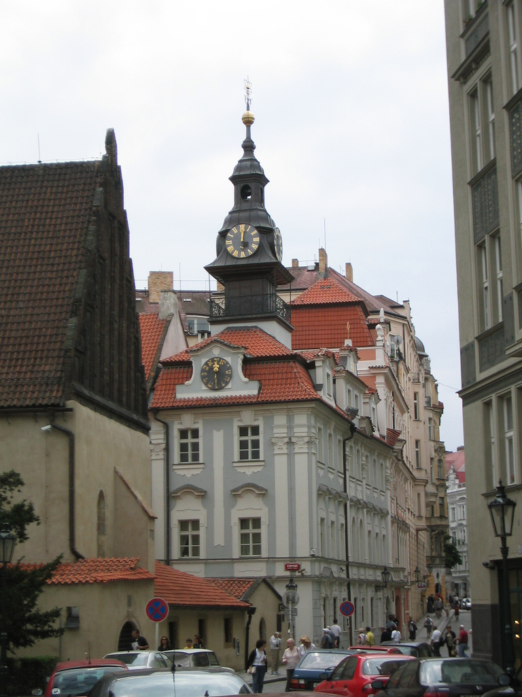
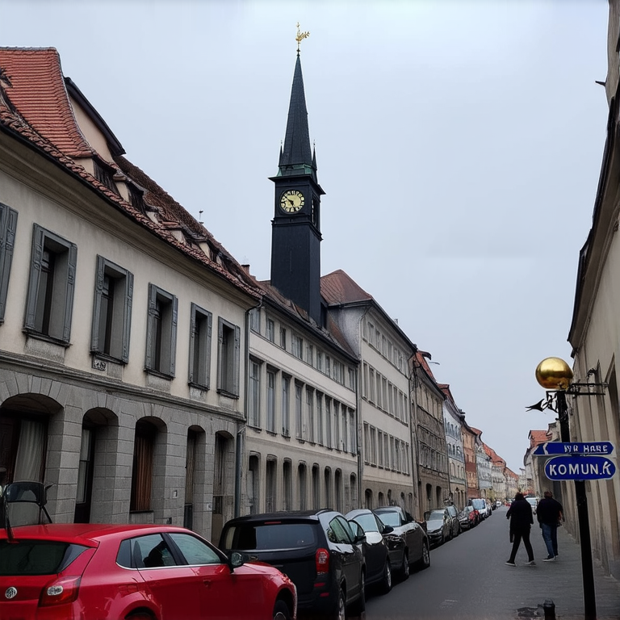
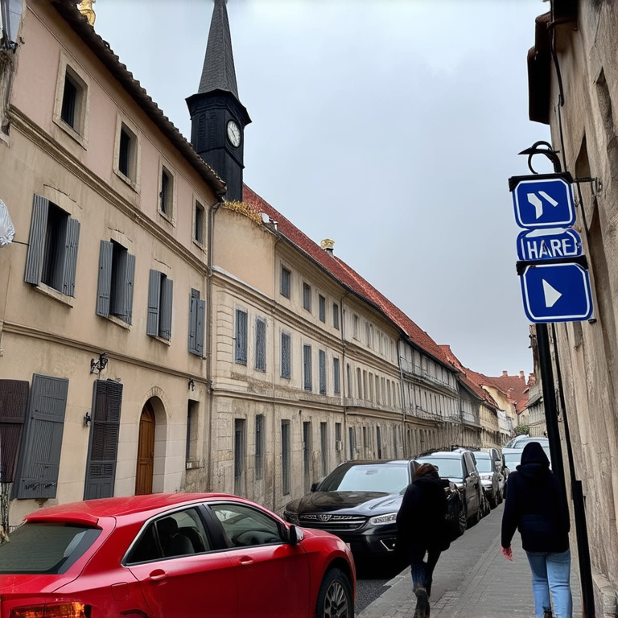
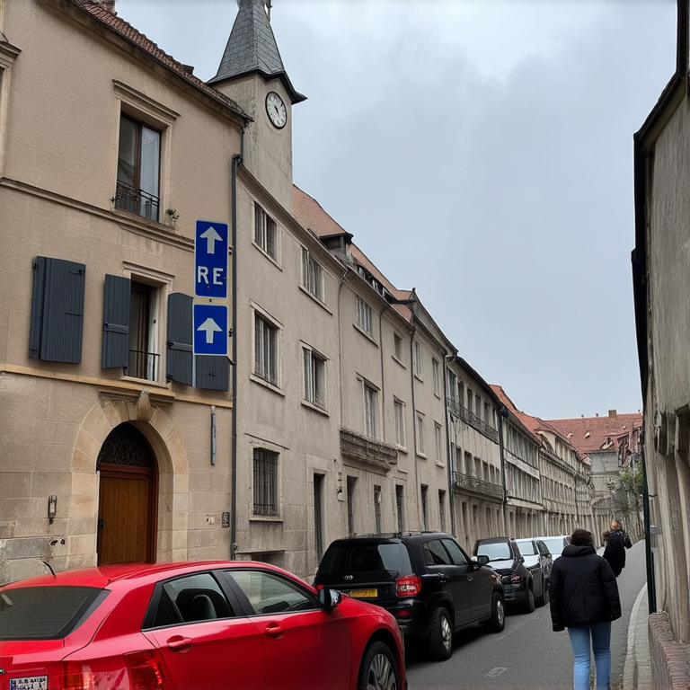
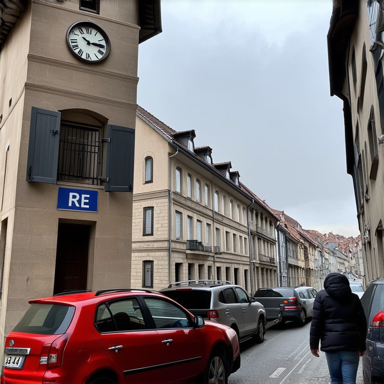
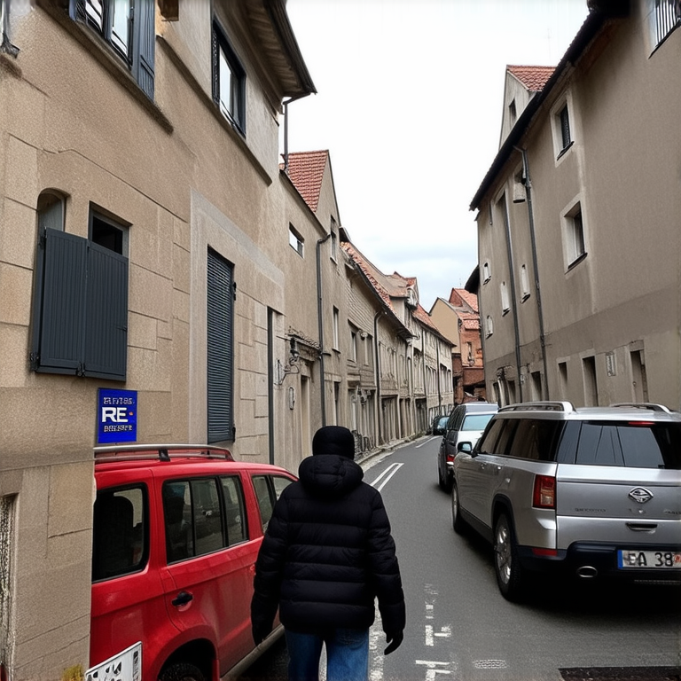

# 单张迭代测试结果

样本是 `all_five_objects_sorted_by_attributes.csv` 的第 1 行，`image_id` 为 **497948**。链路从原图跑到第 5 代，并额外记录了第 5 代的描述。运行成功，退出码 0。

原始输出在 `runs/single_497948/`：

| 文件 | 内容 |
|---|---|
| `I0.jpg` | Visual Genome 原图 |
| `I1.png` … `I5.png` | 各代生成图 |
| `T1.txt` … `T5.txt` | 上一代图片的描述，同时是下一代的生图 prompt |
| `T6.txt` | `I5` 的描述，没有送进 SD3 |
| `config.json` | 本次冻结的超参数 |
| `meta.json` | 耗时、token 数、Ground Truth |
| `run.log` | 运行日志 |

## 设置

| 项 | 值 |
|---|---|
| 环境 | `HISpy3.10`，PyTorch 2.4.1+cu118 |
| GPU | NVIDIA GeForce RTX 4060 Laptop，8GB |
| 图转文 | `D:\models\Qwen3-VL-4B-Instruct` |
| 文生图 | `D:\models\stable-diffusion-3-medium` |
| VLM 解码 | 贪婪解码（`do_sample=false`），`max_new_tokens=384` |
| VLM 图像上限 | 1024×1024 像素 |
| SD3 | 28 steps，`guidance_scale=7.0`，负面 prompt 为空 |
| 分辨率 | 768×768（8GB 上先试 768，成功后锁定） |
| seed | 497948，每一代相同 |
| 原图 | https://cs.stanford.edu/people/rak248/VG_100K/497948.jpg |

VLM 每轮使用同一段固定 prompt，描述原样交给 SD3，只去掉首尾空白。CSV 里的 man、window、tree、building、shirt 及其 attributes 写在 `runs/single_497948/meta.json` 的 `ground_truth_not_used_in_prompts`，没有进入任何 prompt。

## 耗时

各阶段秒数来自 `runs/single_497948/meta.json`，包含该阶段的模型加载。合计 **1472.5 秒（约 24.5 分钟）**。

| 阶段 | 输入 | 输出 | 秒 | 字符 | CLIP-L / CLIP-G | T5 |
|---|---|---|---:|---:|---:|---:|
| caption | I0 | T1 | 329.5 | 1401 | 296 / 296 | 332 |
| diffuse | T1 | I1 | 117.7 |  | 296 / 296 | 332 |
| caption | I1 | T2 | 235.2 | 1033 |  |  |
| diffuse | T2 | I2 | 82.9 |  | 218 / 218 | 251 |
| caption | I2 | T3 | 214.2 | 1221 |  |  |
| diffuse | T3 | I3 | 45.4 |  | 248 / 248 | 288 |
| caption | I3 | T4 | 132.0 | 1197 |  |  |
| diffuse | T4 | I4 | 43.7 |  | 259 / 259 | 291 |
| caption | I4 | T5 | 111.9 | 1058 |  |  |
| diffuse | T5 | I5 | 44.4 |  | 226 / 226 | 255 |
| caption | I5 | T6 | 115.6 | 1034 |  |  |

## 各代图像

### I0 原图

街道、红色瓦屋顶、一座带两个金色钟面的钟楼。前景有车和多名行人，画面左下有树。

### I1

仍是钟楼街道。塔身变成细高的黑色尖顶，行人变少，前景出现一辆大红车。

### I2

### I3

### I4

### I5

钟楼消失。窄巷中一名穿黑色羽绒服的人背对镜头走在路中间，左侧红车，右侧银色 SUV。米色墙面和红瓦还在。

## 各代描述

描述由 Qwen3-VL 生成。`T1` 到 `T5` 分别是下一代的生图 prompt。`T6` 没有再送进 SD3。

### T1（描述 I0，生成 I1）

The image depicts a street scene with a prominent clock tower rising above a row of multi-story buildings under an overcast sky. The clock tower, constructed of dark material, features a black spire topped with a golden sphere and a weather vane, and houses two visible clock faces: one on the main tower face with gold numerals and hands, and another smaller clock on a decorative pediment below, also with gold numerals and hands. The buildings surrounding the tower have red-tiled roofs and facades in light gray and off-white, with ornate window frames and decorative cornices. A dark, steeply pitched roof of a building on the left contrasts with the red tiles. In the foreground, several cars are parked along the street, including a red car and a dark-colored car, with a blue circular traffic sign with a red border visible on the left side of the road. A black lamppost stands on the right side of the street, and pedestrians are scattered along the sidewalk, some walking and others standing. A small red sign with white text reading "KOMUNÁLNÍ" is mounted on a post near the base of the clock tower. The buildings extend into the distance, showing a mix of architectural styles and colors, including beige, cream, and pale pink, with windows of varying sizes and shapes. The overall scene is urban and appears to be in a European city, with the clock tower serving as a central focal point.

### T2（描述 I1，生成 I2）

The image depicts a narrow street lined with multi-story buildings under an overcast sky. On the left, a row of buildings with light-colored facades, gray shutters, and red-tiled roofs extends along the street, with arched ground-floor windows and rectangular upper windows. A prominent black clock tower with a pointed spire and a golden clock face rises above the buildings, topped by a golden weathervane. Parked along the street are several cars, including a bright red hatchback in the foreground and a dark-colored SUV behind it. On the right side of the street, a black lamppost with a golden spherical top holds two blue directional signs reading "VU HARE" and "KOMUN.Ř" in white lettering. Two pedestrians are walking on the sidewalk to the right, one in dark clothing and the other in jeans and a dark jacket. The street surface is paved, and the buildings appear to be constructed from stone or stucco, with visible windows and doors. The overall scene is static, with no visible motion or activity beyond the pedestrians.

### T3（描述 I2，生成 I3）

The image depicts a narrow street lined with multi-story buildings under an overcast sky. On the left, a long building with a pale beige facade features numerous windows with dark gray shutters, some open, and a central arched doorway with a wooden door; above it, a tall, dark gray clock tower with a pointed spire and a visible clock face rises from the roofline, which is covered in reddish-brown tiles. Parked along the street are several vehicles, including a bright red hatchback in the foreground on the left, a black SUV directly behind it, and other cars further down the road. On the right side of the street, a vertical set of three blue rectangular traffic signs is mounted on a black pole; the top sign shows a left-turn arrow, the middle sign reads "HARE" in white capital letters, and the bottom sign displays a right-turn arrow. Two pedestrians are walking on the sidewalk to the right, both dressed in dark jackets and jeans, moving away from the camera. The buildings exhibit stone or stucco exteriors with consistent window patterns and shutters, and the street appears paved with cobblestones or similar material. The overall scene is static, with no visible motion or activity beyond the pedestrians.

### T4（描述 I3，生成 I4）

The image depicts a narrow street lined with multi-story buildings under an overcast sky. On the left, a beige stone building with a clock tower featuring a dark gray conical roof and a white-faced clock with black hands and numerals rises above the structure; below the tower, a blue rectangular sign with white upward-pointing arrows and the letters "RE" is mounted on the wall. The building has dark gray wooden shutters on its windows, some of which are open, and an arched wooden door at ground level. A red hatchback car is parked in the foreground on the left, its rear and side visible, with a European license plate reading "AL 841 A". Behind it, a black SUV is parked, followed by other vehicles including a dark sedan and a silver car. On the right side of the street, a person in a black puffer jacket and blue jeans walks away from the camera, while another person in a dark coat is further down the street. The buildings extend into the distance, showing rows of windows with metal grilles and some with wrought iron balconies, and the rooftops are covered in reddish-brown tiles. The street surface is paved, and the sidewalk runs along the right side, bordered by a low brick curb.

### T5（描述 I4，生成 I5）

The image depicts a narrow urban street under an overcast sky, flanked by multi-story buildings with beige stone facades and red-tiled roofs, some featuring dormer windows and dark gray shutters. On the left, a prominent building with a clock tower displays a white-faced clock with black Roman numerals and hands, mounted above a dark gray shuttered window; below the window, a blue rectangular sign with the white letters "RE" is affixed to the wall. Parked along the street are several vehicles: a red hatchback with a visible license plate reading "33 44" is in the foreground, followed by a silver SUV, a dark gray SUV, and a silver sedan. A person wearing a black puffer jacket and blue jeans walks away from the camera on the right side of the street, moving along the pavement. The street surface is paved, with white road markings visible, and the buildings recede into the distance, creating a perspective that emphasizes the narrowness of the alley. The overall scene is static, with no visible motion or activity beyond the pedestrian’s movement.

### T6（描述 I5，未再生图）

The image depicts a narrow urban street flanked by multi-story buildings with beige stone facades and red-tiled roofs, under an overcast sky. On the left, a red SUV is parked with its rear facing the viewer, partially obscured by a blue sign with white text reading "RE- BONNE" mounted on the building wall. A person wearing a black puffer jacket with a hood, blue jeans, and dark gloves is walking away from the camera down the center of the street, positioned between the parked vehicles. To the right, a silver SUV is parked with its rear facing the viewer, displaying a license plate with the characters "EA 38" and a diamond-shaped emblem on the tailgate. The street surface is paved asphalt with white painted lines, including a dashed line and a solid line near the curb. The buildings have windows with dark gray shutters, some open, and vertical downspouts running along the walls. The perspective is from a low angle, looking down the street which recedes into the distance, with the buildings converging toward the horizon.

## 这一张上能看到的漂移

对照原图、各代图片和上面的描述：

- 街道、米色或浅色墙面、红瓦屋顶从 I0 保留到 I5。
- 钟楼在 T1–T5 里都还被提到。I0 上是两个金色钟面的矮塔，I1 已变成黑色细尖顶。T6 不再提到钟楼，I5 画面里也没有钟楼。
- 行人从街上的一群人收成一名穿黑色羽绒服、背对镜头的人。
- 路牌文字逐代改写：T1 的 “KOMUNÁLNÍ”，T2 的 “VU HARE” / “KOMUN.Ř”，T3 的 “HARE”，T4–T5 的 “RE”，T6 的 “RE- BONNE”。
- 车牌是后几代才出现的文字：T4 “AL 841 A”，T5 “33 44”，T6 “EA 38”。
